<p align="center">
  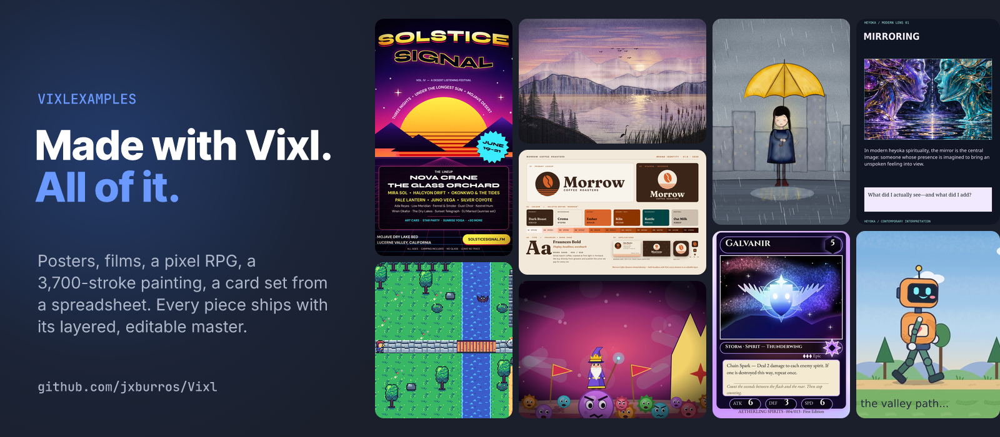
</p>

# VixlExamples

**Everything here was made with [Vixl](https://github.com/jxburros/Vixl).** A festival poster. A brand identity.
A pixel RPG that walks. A 3,700-stroke painting. A 200-badge print run from a spreadsheet. Four films, one of them
scored by a synthesiser written as Vixl operations. It's what I made while building the engine, because the fastest
way to find out what a design engine can't do yet is to ask it for something ridiculous.

Vixl is a design engine for AI agents, and these are the receipts. Nothing here is a flat picture of a thing. The
marketing pack, the four films and the Heyoka collection ship their `.vixl` masters, so you can open the deck and change
a headline, open a film and move a keyframe, or open the chart in PowerPoint and click **Edit Data**. The ten big
builds ship the Python script that makes theirs: run it and you get the master, and read it to see exactly which
operations made each piece.

[Watch the films](#watch-first) · [Ten big builds](#ten-big-builds) · [Painted by operations](#painted-by-operations) ·
[A marketing department in a folder](#a-marketing-department-in-a-folder) · [Do the evals back this up?](#do-the-evals-back-this-up) ·
[Run it yourself](#run-it-yourself) · [Map of the repo](#map-of-the-repo)

## Watch first

Four films. Every frame is an editable Vixl document, and every soundtrack is synthesised in code.

<table>
<tr>
<td width="50%" valign="top">
<a href="promo/vixl-is-fun/vixl-is-fun-extended.mp4"></a>

**[Vixl is fun](promo/vixl-is-fun/README.md)** · 1:50<br>
A bouncing ball, a jellyfish from one line of JSON, a garden grown from seeds, "same words, 28 outfits", a
paper-cut character that explodes into its 20 layers. Then the second half walks through the real work in this
repo, with the code that made it on screen.
</td>
<td width="50%" valign="top">
<a href="promo/it-does-that/vixl-it-does-that.mp4">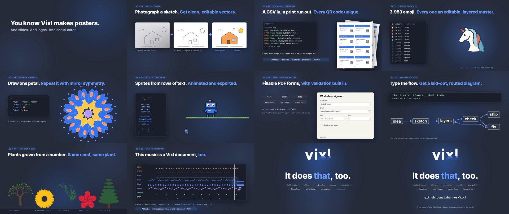</a>

**[It does that?](promo/it-does-that/README.md)** · 0:57<br>
Nine things you wouldn't expect from a design engine: a phone photo of a pen sketch turned into clean vectors, 200
badges with 200 different QR codes, 3,953 emoji that come apart into layers, a mandala from one petal, and a piano
roll of the film's own score.
</td>
</tr>
<tr>
<td width="50%" valign="top">
<a href="movie/the-germ-king.mp4">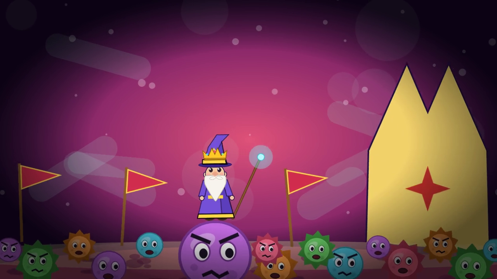</a>

**[The Germ King](movie/README.md)** · 0:51<br>
*A very small revenge.* Wizard Pip is too short for the Council of the Very Tall, so he shrinks himself, becomes king
of the germs, and marches them on the Council. Eight scenes, 180 to 410 layers each, speech blips timed to the
mouth flaps. Nothing hand-painted, imported or sampled.
</td>
<td width="50%" valign="top">
<a href="promo/vixl-in-60-seconds.mp4">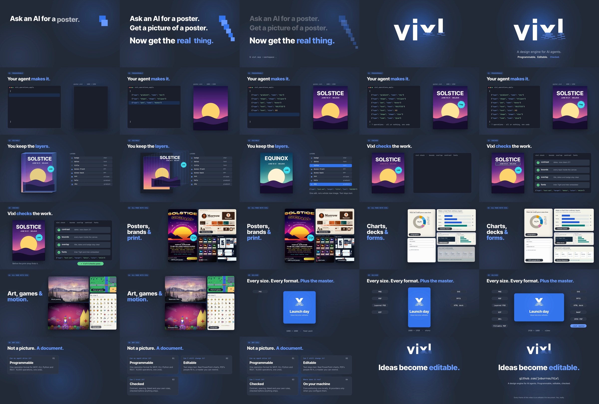</a>

**[Vixl in 60 seconds](promo/README.md)** · 1:00<br>
The pitch, as a film. The contrast failure in the "checked" shot is real: the build runs the check, quotes the 2.66:1
ratio Vixl reported, applies the fix and stops if any `fix` finding is left.
</td>
</tr>
</table>

There's also a [promo variety pack](promo/variety/README.md): six editable video treatments (kinetic type, neon
geometry, a statistic reveal and more) that you can spin up from a template in one command.

## Ten big builds

I started these to find where Vixl broke. Each one stretches a different corner of the engine, has a reproducible
`build.py`, and wrote up what it found. Most of those findings were fixed in Vixl afterwards. The
[explorations README](explorations/README.md) has the full list.

<table>
<tr>
<td width="33%" valign="top">
<a href="explorations/01-print-concert-poster/">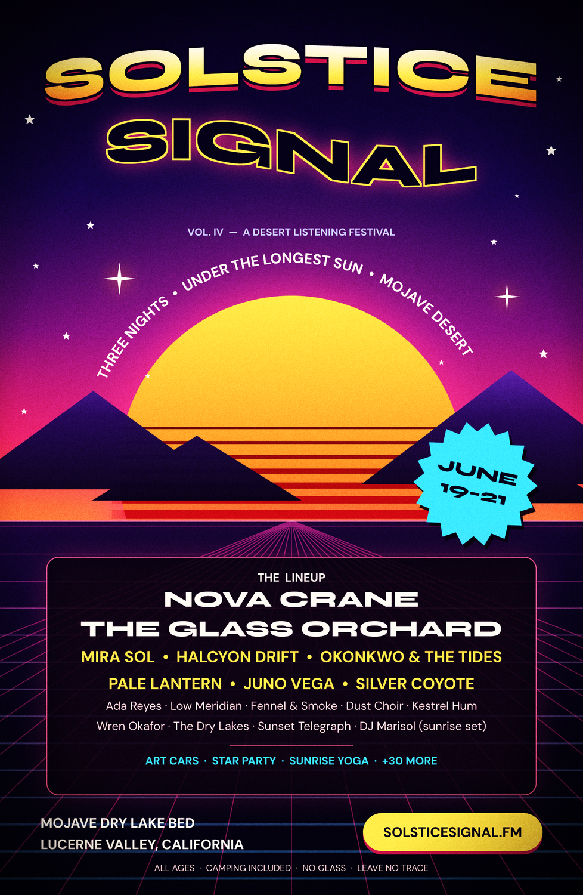</a>

**[A print-ready festival poster](explorations/01-print-concert-poster/)**<br>
11 × 17 in with bleed. A sliced-gradient sun, text bent along an arc, a CMYK PDF with trim and bleed boxes, a SWOP soft
proof, and colour-blindness simulations.
</td>
<td width="33%" valign="top">
<a href="explorations/02-brand-identity/">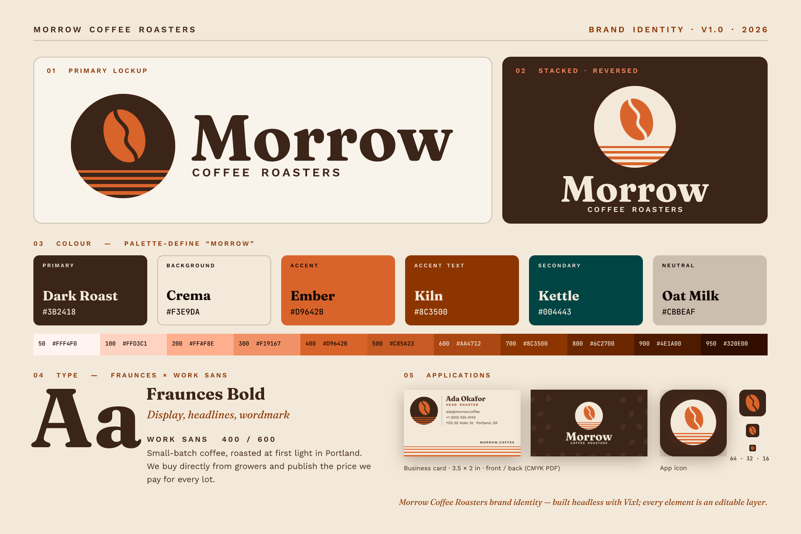</a>

**[A coffee roaster's whole identity](explorations/02-brand-identity/)**<br>
Logo drawn with pen Béziers, a generated palette, business cards in vector CMYK, a favicon and app-icon set, and a
brand board that passes its own checks.
</td>
<td width="33%" valign="top">
<a href="explorations/03-kinetic-launch/">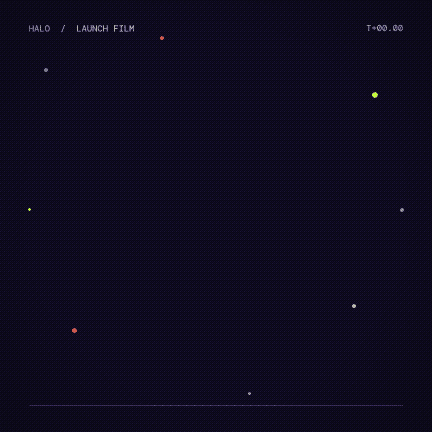</a>

**[A launch film in 8 seconds](explorations/03-kinetic-launch/)**<br>
Keyframes, easings, staggers and animated glows, exported as GIF, WebP, APNG and MP4 from one timeline.
</td>
</tr>
<tr>
<td width="33%" valign="top">
<a href="explorations/04-pixel-rpg/">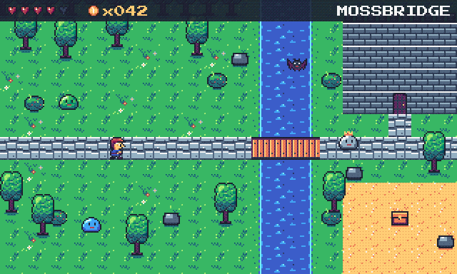</a>

**[A pixel RPG, from strings](explorations/04-pixel-rpg/)**<br>
A 16 × 16 hero is 16 strings and a palette. Walk and attack cycles, palette-swapped variants, a tileset and a tile map,
all exported with nearest-neighbour scaling so the pixels stay sharp.
</td>
<td width="33%" valign="top">
<a href="explorations/05-generative-painting/"></a>

**[A mountain lake, stroke by stroke](explorations/05-generative-painting/)**<br>
3,723 seeded strokes on 26 paint layers, all 17 brushes plus custom ones, a timelapse, and four artistic-filter
versions of the same document.
</td>
<td width="33%" valign="top">
<a href="explorations/06-photo-lab/">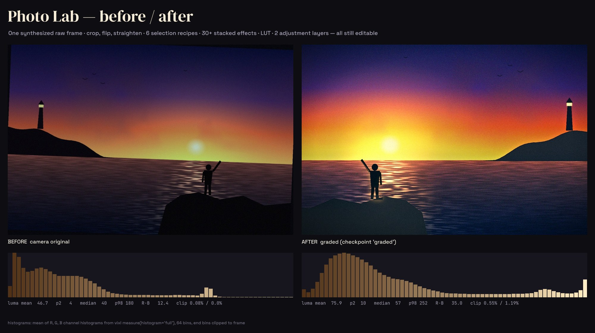</a>

**[A photo edit you can undo](explorations/06-photo-lab/)**<br>
Straighten, crop, grade with a LUT, mask with every selection kind. Each step is a layer or an effect, and the history
branches, so before and after are both still there.
</td>
</tr>
<tr>
<td width="33%" valign="top">
<a href="explorations/07-trading-cards/">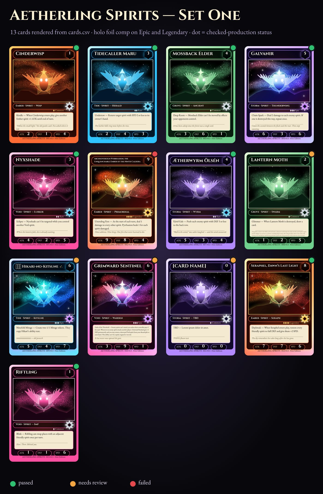</a>

**[A card set from a spreadsheet](explorations/07-trading-cards/)**<br>
One template and a 13-row CSV, including a 70-character name, Latin accents, CJK and emoji. Holo foil on the rare ones,
and a CMYK print sheet.
</td>
<td width="33%" valign="top">
<a href="explorations/08-infographic/">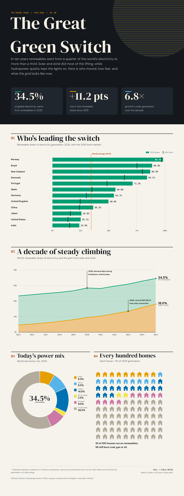</a>

**[An infographic built from shapes](explorations/08-infographic/)**<br>
Charts drawn from data with repeats and paths, then SVG, HTML and PDF. The figures are invented, and the README says
so. The checks also caught a real contrast error, which I left in.
</td>
<td width="33%" valign="top">
<a href="explorations/09-collab-campaign/">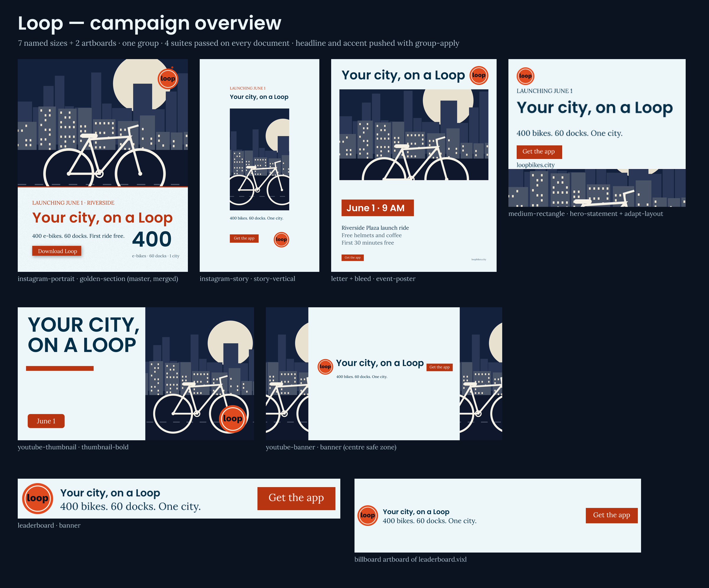</a>

**[One campaign, seven sizes](explorations/09-collab-campaign/)**<br>
Brand rules, layouts that adapt from story to banner, and branches forked and merged with every conflict resolved
explicitly, then published only if the saved checks pass.
</td>
</tr>
<tr>
<td width="33%" valign="top">
<a href="explorations/10-character-film/">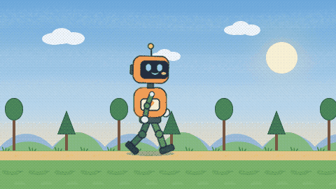</a>

**[Pip the robot](explorations/10-character-film/)**<br>
A rigged character with pivots at every joint: a walk, a wave and a jump with squash and stretch, in front of a
three-layer parallax valley.
</td>
<td width="33%" valign="top">
<a href="explorations/logo-alternatives/"></a>

**[Where the Vixl logo came from](explorations/logo-alternatives/)**<br>
Dozens of marks, built as editable documents over several rounds. One idea survived: an x and an l that are the
reflection of the v and the i.
</td>
<td width="33%" valign="top">
<a href="explorations/README.md">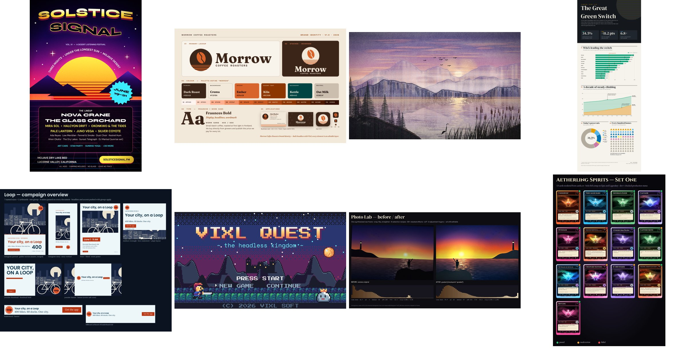</a>

**[The whole set](explorations/README.md)**<br>
The ten at a glance, build times, what each one found, and what changed when they were rebuilt.
</td>
</tr>
</table>

## Painted by operations

<table>
<tr>
<td width="40%" valign="top">
<a href="art/README.md">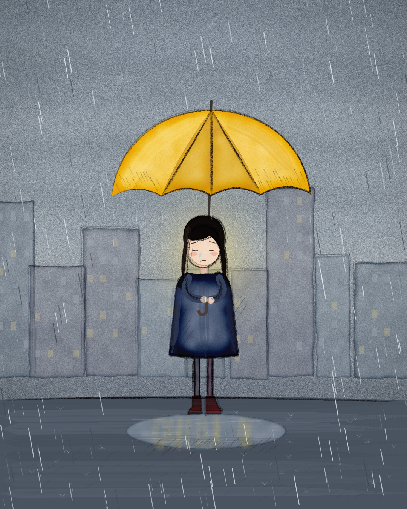</a>
</td>
<td valign="top">

**Rain girl.** 768 operations, 651 of them brush strokes, replayed from [one JSON file](art/rain-girl-ops.json). The
umbrella is watercolor, the rain is its own paint layer of streaks, and the street holds a puddle with the windows
reflected in it. Vixl's `watercolor` look pools pigment at edges, which is lovely on an umbrella and ruinous on a
full-width street, so the recipe leaves the ground out of it. That's the kind of thing you only find by painting
something.

**[Heyoka: Mirrors &amp; Paradox](art/heyoka-mirrors-paradox/)** is an 18-piece editorial collection: six posters, six
study cards, an essay booklet, a deck with a PowerPoint, a carousel, an animated mirror, an archetype map and a
fillable journal PDF.
The illustrations were generated as one raster sheet and then placed; Vixl does the crops, the typography, the pages
and the exports, so every essay is still live text.
</td>
</tr>
</table>

## A marketing department in a folder

The [marketing pack](marketing/README.md) is 17 pieces of Vixl's own marketing, built by one script and verified by
another: social cards, a six-slide carousel, a 12-slide deck that opens in PowerPoint with a native chart, a
fillable PDF brief, a CMYK tabloid poster with a vector QR code, a sticker sheet, a data-driven social campaign,
a looping app-animation family with light and dark themes, and an offline proof page for review. Each piece has
saved checks, and the build refuses to export anything with a `fix` finding.

<a href="marketing/README.md">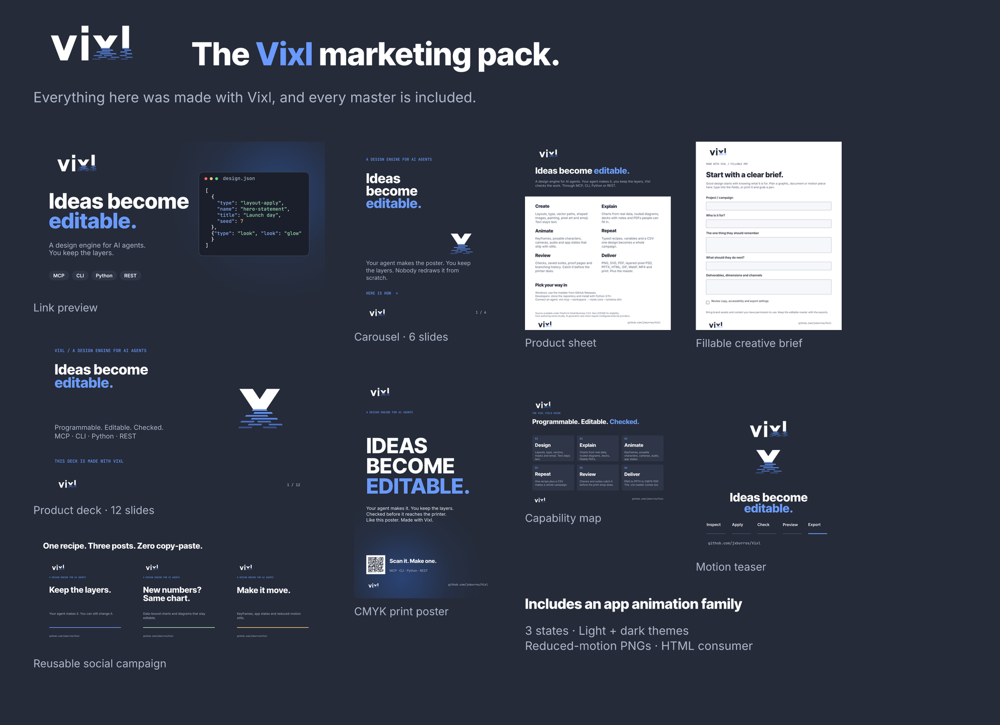</a>

## Small things I couldn't resist

- **[A lyric video](showcases/README.md)** from an `.lrc` file and original lyrics: styled template, synthesised
  melody, synced words.
- **[A cut-paper scene](showcases/README.md)** with held-frame animation and rough paper edges.
- **[An emoji pack](packs/emojis/README.md)** of about 4,000 emoji and 100 originals, each an editable layered
  master. Vixl downloads it the first time you put an emoji in text.
- **[A QA report](qa-reports/README.md)** typeset in Vixl: 24 pages on a stress test of release 0.22.0 that
  found 100 issues, and the data behind it.

## Do the evals back this up?

Mostly, and the places they don't are published too. The [tool comparison](evals/tool-comparison/README.md) hands
the same 16 briefs (poster, deck, fillable form, badges, infographic, lyric video and more) to the same model
using Vixl, web code, Python and command-line tools, then judges the results blind.

- **Where Vixl is strong:** an agent finished 31 of 31 live tasks at about 7 tool calls each. A fresh session could
  change a finished piece in place, with a median editability of 5 out of 5. Every run report matched the files.
- **Where it loses:** judged blind on craft, web code beat Vixl in 16 of 27 side-by-side calls, mostly by a slight
  margin. Spacing and rhythm are the weak spots, and the reports name the defects.

[The current scores](eval-results/2026-10-13-blind-rejudging.md), the [gallery of every
deliverable](eval-results/2026-10-12-gallery.md) and the [index of reports](eval-results/README.md) are all here. The kit
is built so you can run it yourself.

## Run it yourself

Everything here needs Python 3.11 or later and Vixl from PyPI. You don't need a clone of the Vixl repository.

```bash
python -m pip install 'vixl-engine[server,pdf]'
git clone https://github.com/jxburros/VixlExamples && cd VixlExamples

python explorations/04-pixel-rpg/build.py        # 19 seconds: the pixel RPG
python marketing/build.py og deck                # two marketing pieces
vixl -p marketing/output/social/og-card-1200x630.vixl view             # open a master in live review
```

Some notes before you start:

- **Fonts download once.** Builds fetch their Google Fonts the first time and cache them. The masters embed their
  fonts, so *opening* a file never needs the network.
- **Films need ffmpeg** on your `PATH`. `movie/` takes about 19 minutes to render on a shared 4-core container; the
  explorations take 16 seconds to 2 and a half minutes each.
- **Rebuilds regenerate.** A build rewrites its own outputs, masters included. Copy a master somewhere else before you
  start editing it by hand.
- **Each folder's README says which Vixl version built its outputs.** Rebuilding with a newer release can change them
  slightly, and the READMEs list what changed in the last rebuild.

## Map of the repo

| Folder | What's in it |
| --- | --- |
| [`explorations/`](explorations/README.md) | The ten big builds and the logo alternatives |
| [`promo/`](promo/README.md) | *Vixl in 60 seconds*, [*It does that?*](promo/it-does-that/README.md), [*Vixl is fun*](promo/vixl-is-fun/README.md) and the [variety pack](promo/variety/README.md) |
| [`movie/`](movie/README.md) | *The Germ King* |
| [`art/`](art/README.md) | *Rain girl* and *Heyoka: Mirrors & Paradox* |
| [`marketing/`](marketing/README.md) | The 17-piece marketing pack with its build and verify scripts |
| [`showcases/`](showcases/README.md) | The lyric video and the cut-paper scene |
| [`packs/`](packs/README.md) | Content packs Vixl downloads on demand, such as the emoji artwork |
| [`evals/`](evals/README.md) | The tool-comparison kit and recordings of live agent runs |
| [`eval-results/`](eval-results/README.md) | Written evaluation reports and the blind re-judging |
| [`qa-reports/`](qa-reports/README.md) | Release QA reports |
| [`assets/`](assets/README.md) | This README's banner, and the copies of Vixl's brand kit that the builds use |

## Adding to this repository

New showcases, experiments, generated media and evaluation results go here, not in the Vixl repository. Give each a
folder with a README that says what it is, which Vixl version built it and how to rebuild it, commit the `.vixl`
master next to every export, and add a row to the table above. Vixl links to this repository for its galleries, but
Vixl never needs it to run: nothing in the engine imports from here.

## Licence

The Vixl engine is [source-available](https://github.com/jxburros/Vixl/blob/main/LICENSE) under PolyForm Small
Business 1.0.0. Fonts keep their own licences (see `marketing/output/licenses/`), the emoji pack is
[CC BY-SA 4.0](packs/emojis/LICENSE.txt), and the *Heyoka* illustrations are generated artwork placed by Vixl. Please
credit work you make with Vixl.
