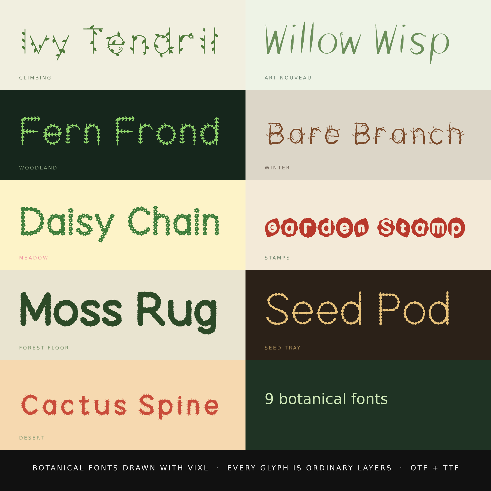

# Botanical fonts

Nine plant-themed fonts. See [`../README.md`](../README.md) for how they are made.

| Font | Look |
| --- | --- |
| Ivy Tendril | Thin climbing-vine letters with leaves and curling tendrils |
| Willow Wisp | Art Nouveau strokes that swell and curl like willow shoots |
| Fern Frond | Letters grown from pinnate fern fronds |
| Bare Branch | Tapering winter twigs with side shoots and buds |
| Daisy Chain | A daisy stamped along every stroke, each turned differently |
| Garden Stamp | Letters knocked out of leaf, egg and scalloped-blossom tiles |
| Moss Rug | Fuzzy, furry moss edges |
| Seed Pod | Strings of seeds |
| Cactus Spine | Fat strokes bristling with spines |

Ivy Tendril, Fern Frond, Daisy Chain and Seed Pod have fine detail that only shows at larger sizes; at body size
they read as texture.
