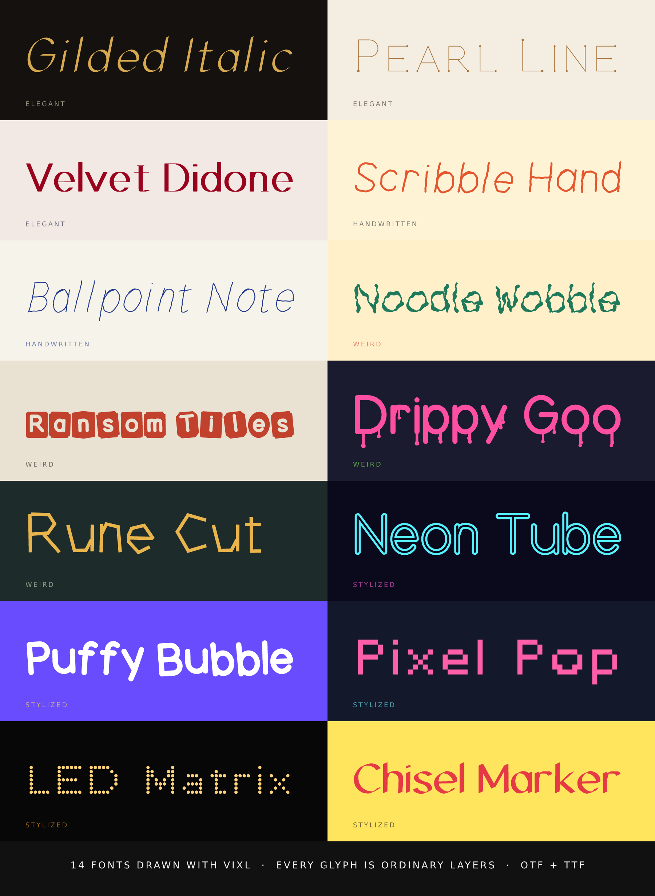

# Display fonts

Fourteen fonts: elegant, handwritten, weird and stylized. See [`../README.md`](../README.md) for how they are made.

| Font | Look |
| --- | --- |
| Gilded Italic | Broad-nib chancery italic: hairlines up, thick strokes down |
| Pearl Line | Hairline all-caps with pearl terminals; lowercase is small caps |
| Velvet Didone | High-contrast fashion-magazine capitals and lowercase with hairline serifs |
| Scribble Hand | Fat felt-marker hand, a little different every letter |
| Ballpoint Note | Narrow, leaning blue-biro margin notes |
| Noodle Wobble | Wobbly, lumpy noodle strokes that swell and pinch |
| Ransom Tiles | Letters knocked out of mismatched, tilted cut-paper tiles |
| Drippy Goo | Fat slime letters with drips |
| Rune Cut | Angular, hand-chiselled facets |
| Neon Tube | Double-line neon tubing |
| Puffy Bubble | Inflated balloon letters |
| Pixel Pop | Chunky square pixels on a grid (a few hand-set bitmaps) |
| LED Matrix | Round LED dots on a pixel grid |
| Chisel Marker | Bold flat-cut chisel marker |
