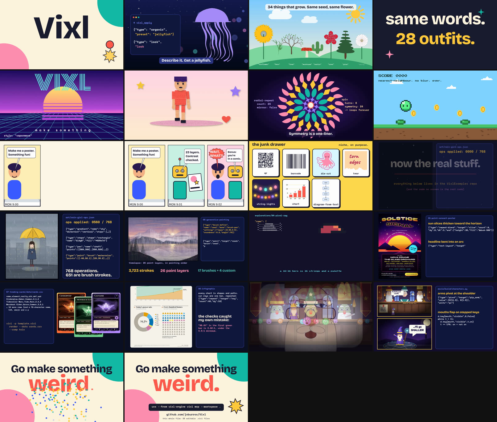

# Vixl is fun

**A 1:50 film that tries to convince you Vixl is fun to use.** Every frame is a Vixl document, the captions are
text layers, and the score is synthesised by Vixl's own instruments, locked to a 100 bpm grid so the cuts land on
the beats. The second half walks through real work from this repository and shows the code that made it.

**[`vixl-is-fun-extended.mp4`](vixl-is-fun-extended.mp4)** · 110.4 s · 1280×720 · 25 fps · AAC mono 48 kHz · 13 MB
**[`vixl-is-fun-short.mp4`](vixl-is-fun-short.mp4)** · 57.6 s, the same film without the repository section · 7.6 MB



## The cut

| Time | Scene | What it shows |
| --- | --- | --- |
| 0:00 | `s01` | A ball bounces across the letters of "Vixl" (`keyframes`, `text-animate`) |
| 0:05 | `s02` | JSON types itself out and a jellyfish appears (`organic`), then a `neon` look |
| 0:10 | `s03` | A garden from eight `organic` presets; they pop up from the ground and sway |
| 0:14 | `s04*` | "Same words. 28 outfits.", then eight styles in eight beats: Bauhaus, vaporwave, neo-brutalist, risograph, art deco, Y2K, Japanese minimal, 8-bit |
| 0:21 | `s05` | Pip, a paper-cut `character` with a `walk` and `wave` cycle, `cut-paper` grain and held frames; it explodes into its 20 layers |
| 0:29 | `s06` | A four-ring mandala from `radial-repeat` and `spin`, a seamless loop |
| 0:34 | `s07` | A pixel slime hops across a landscape and collects coins (`pixel-art`, stepped `visible` keys, a `text` key for the score) |
| 0:38 | `s08` | A three-panel comic (`comic-layout`, `speech-bubble`) that ends with a `camera` push-in |
| 0:46 | `s09` | The junk drawer: `qr`, `barcode`, `die-cut`, `tear`, `string-lights`, `chart`, `diagram-from-text` and emoji |
| 0:50 | `x0`–`x8` | **The real stuff** (below) |
| 1:43 | `s10` | "Go make something weird." The install command, with confetti from `particles` |

### The real stuff (0:50 to 1:43)

| Time | Scene | Work | How it was made |
| --- | --- | --- | --- |
| 0:50 | `x0` | | Title card |
| 0:53 | `x1` | [Rain girl](../../art/rain-girl.png) | `rain-girl-ops.json` is replayed in Vixl and rendered after 14 of its 768 operations, with an "ops applied" counter and real `gradient`, `shape`, `pen`, `paint` and `look` operations alongside (shortened to fit) |
| 1:00 | `x2` | [Mountain painting](../../explorations/05-generative-painting/) | The timelapse, then the same document through four artistic filters; the `brush-define` and `paint` operations for the reeds |
| 1:07 | `x3` | [Pixel RPG](../../explorations/04-pixel-rpg/) | The hero's real `HERO_BODY` and stand-pose rows, typed in as the sprite builds up row by row, then the animated overworld map |
| 1:14 | `x4` | [SOLSTICE SIGNAL poster](../../explorations/01-print-concert-poster/) | The real `repeat-blend`, `text-layout` warp and `constrain` operations, then the SWOP soft proof and colour-blindness simulations |
| 1:22 | `x5` | [Trading cards](../../explorations/07-trading-cards/) | A few `cards.csv` rows and the `render --data` command, with the standard and holo cards |
| 1:26 | `x6` | [Infographic](../../explorations/08-infographic/) | A scroll down the whole poster, the `repeat` that draws the sun rays, and the contrast error the checks found and the design kept |
| 1:31 | | [The Germ King](../../movie/) | The sneeze, cut from `the-germ-king.mp4` (the one shot that is a video clip, not a document) |
| 1:36 | `x8` | The Germ King's build code | `pivot` on `pip_armL` and the stepped `visible` keys that flap the mouths, from `movie/build/characters.py` and `scenes.py` |

The code on screen is real. Long lines are shortened with `…`, and the poster's `px()` helper values are shown
already resolved.

## What is in this folder

| Path | What it is |
| --- | --- |
| `vixl-is-fun-extended.mp4`, `vixl-is-fun-short.mp4` | The finished films (the short one is the first 57 seconds with its own outro; it predates the repository section) |
| `scenes/*.vixl` | 26 editable 1280×720 masters with keyframe timelines. `x3` is large (21 MB) because it embeds the 58 frames of the map animation |
| `film-spec.json` | The `film-export` request for the extended cut: shot order, crossfades, camera moves and the seven-track score |
| `build/` | The Python that builds the scenes, the score and the film |
| `work/` | Created by the build and not committed: pulled-out assets, parts, previews |

## Rebuilding

Install Vixl (or set `VIXL_REPO` to a checkout), ffmpeg and Pillow, then run from the root of this repository:

```bash
python promo/vixl-is-fun/build/prepare_assets.py     # pictures for the "real stuff" scenes, from this repo
python promo/vixl-is-fun/build/build_scenes.py       # the 26 scenes in scenes/ (Google Fonts need network)
python promo/vixl-is-fun/build/render.py out.mp4     # 4 processes, 75-frame chunks, joined with the score
python promo/vixl-is-fun/build/remux.py work/parts/video.mp4 mixed.mp4 0.62   # re-mix the score at 0.62x gain
```

I normalised the loudness of the delivered files with
`ffmpeg -i mixed.mp4 -c:v copy -af loudnorm=I=-16:LRA=11:TP=-1.5 -c:a aac -b:a 192k out.mp4`.

## Notes on the build

- **Timing.** The film runs at 25 fps so that a 600 ms beat is exactly 15 frames, and each shot's duration is its
  bar-aligned length plus the next crossfade. The score is in `build/score.py`: one track per role (bass, drums,
  keys, bell, pad, lead, sfx), 100 bpm over C–Am–F–G, with sound effects cued to on-screen events.
- **Speed.** Group scenes with organic shapes re-rendered every frame at about 5 s each, so `s02` and `s03`
  rasterize their organic layers (`rasterize`) before animating them. That made them 20 times faster.
- **Sequences.** The timelapse, the map and the rain-girl stages are raster layers switched on with `hold`
  `visible` keys, so even those scenes are ordinary Vixl documents.
- **Text animation.** `text-animate` with `unit: word` mispositions words for a few frames in centred text, so the
  big title cards use `slide-in-up` on the whole layer instead.
